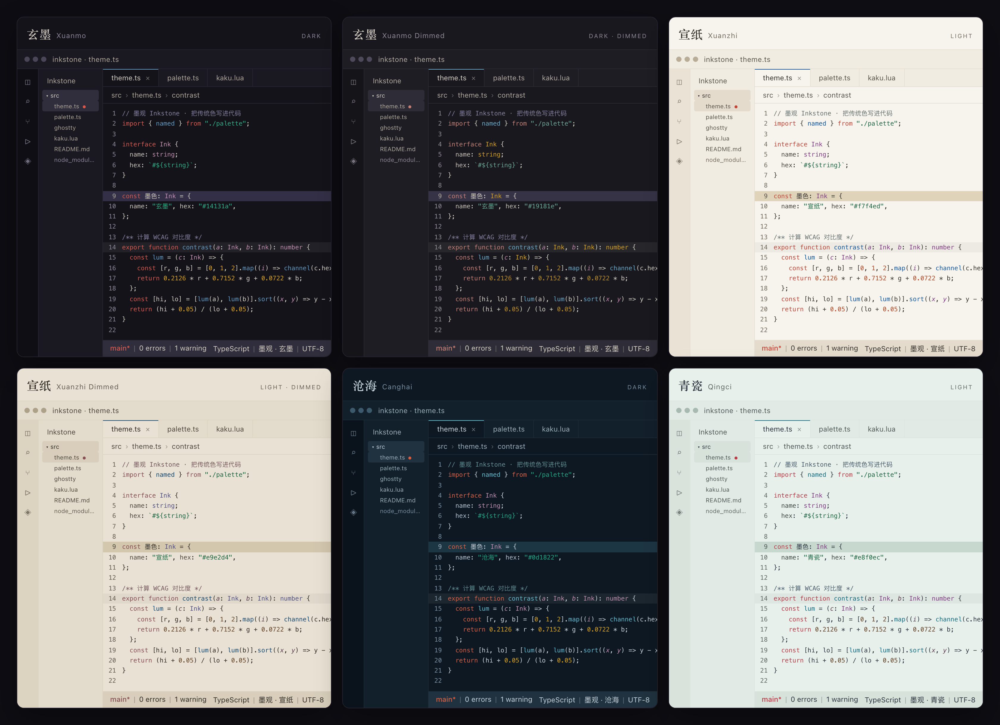

<div align="center">
  
  <h1>墨观 Inkstone</h1>
  <p>一套从 <a href="https://zhongguose.com/">526 个中国传统颜色</a> 里长出来的代码配色。</p>
  <p>
    <a href="https://konata9.github.io/inkstone/">官网</a> ·
    <a href="docs/README.md">文档</a> ·
    <a href="https://github.com/Konata9/inkstone/releases">Releases</a> ·
    <a href="README_EN.md">English</a>
  </p>
  <p>
    <a href="https://konata9.github.io/inkstone/"></a>
    <a href="https://github.com/Konata9/inkstone/stargazers"></a>
    <a href="https://github.com/Konata9/inkstone/releases"></a>
    <a href="https://marketplace.visualstudio.com/items?itemName=Konata9.inkstone"></a>
    <a href="LICENSE"></a>
  </p>
</div>

## 预览



## 为什么是墨观

墨观不是一组随机的暗色主题，而是同一幅画在不同光线下的六个房间。强调色取自 526 个中国传统颜色：关键字用朱砂系，字符串用铜绿或竹绿，类型用土黄或紫色系，中性色则是墨、纸、深海与青瓷釉。

- **六个变体，一套骨架**：色相顺序始终是朱 → 蓝 → 绿 → 橙 → 紫 → 青 → 绛，切换时只换光线与饱和度。
- **红做记号，青做动作**：关键字、标签、错误、删除保留朱砂；按钮、徽标、进度、焦点与选中态统一用各变体的交互蓝。
- **Dimmed 降光不降墨**：画布更沉，墨色仍 ≥ 10.5:1，强调色保留可辨识的色相，不会褪成灰雾。
- **生成器保证一致**：一份语义色板同时生成 VS Code、Ghostty、Kaku、OpenCode、Zed 与 DSH；构建会拒绝落在对比度区间或彩度预算之外的配色。

## 六个变体

### 墨与纸

| 变体 | 气质 | 画布 | 关键字 | 字符串 | 类型 |
| --- | --- | --- | --- | --- | --- |
| **玄墨 Xuanmo**（暗） | 松烟墨底，朱砂批注 | `#14131a` | 鱼鳃红 · 降彩 `#d8574a` | 铜绿 `#2bae85` | 萝兰紫 `#c08eaf` |
| **玄墨 Dimmed**（暗） | 深墨夜色，矿物色低一度 | `#19181e` | 桂红 · 降彩 `#c57f73` | 梧枝绿 `#69a794` | 土黄 `#d6a01d` |
| **宣纸 Xuanzhi**（暖亮） | 生宣暖白，青绿设色 | `#f7f4ed` | 鹤顶红 · 降彩 `#c34435` | 荷叶绿 `#1a6840` | 桔梗紫 `#813c85` |
| **宣纸 Dimmed**（暖亮） | 陈纸暖灰，深墨旧色 | `#e9e2d4` | 烟红 `#894e54` | 荷叶绿 `#1a6840` | 野菊紫 `#525288` |

### 海与瓷

| 变体 | 气质 | 画布 | 关键字 | 字符串 | 类型 |
| --- | --- | --- | --- | --- | --- |
| **沧海 Canghai**（暗） | 深海暮色，青绿矿物 | `#0d1822` | 银朱 · 降彩 `#dc5e41` | 竹绿 `#1ba784` | 萝兰紫 `#c08eaf` |
| **青瓷 Qingci**（亮） | 月白釉底，青灰题字 | `#e8f0ec` | 尖晶玉红 · 降彩 `#bc3a46` | 荷叶绿 `#1a6840` | 桔梗紫 `#813c85` |

完整色值与对比度见 [色板对照](docs/palette.md)。

## 支持的软件

**编辑器**

| 软件 | 安装 |
| --- | --- |
| VS Code / Cursor / Windsurf / VSCodium | [Marketplace](https://marketplace.visualstudio.com/items?itemName=Konata9.inkstone) · [Open VSX](https://open-vsx.org/extension/Konata9/inkstone) · [VSIX](https://github.com/Konata9/inkstone/releases) |
| Zed | `pnpm install:zed` |

**终端与 AI 工具**

| 软件 | 安装 |
| --- | --- |
| Ghostty | `pnpm install:ghostty` |
| Kaku / WezTerm | `pnpm install:kaku` |
| OpenCode | `pnpm install:opencode` |
| DeepSeek Harness (DSH) | `pnpm install:dsh` |

## 安装

### VS Code / Cursor / Windsurf / VSCodium

从 [VS Code Marketplace](https://marketplace.visualstudio.com/items?itemName=Konata9.inkstone) 或 [Open VSX](https://open-vsx.org/extension/Konata9/inkstone) 安装，也可以从 [Releases](https://github.com/Konata9/inkstone/releases) 下载最新 VSIX。扩展 ID 是 `Konata9.inkstone`，同一份 VSIX 适用于所有 VS Code 衍生编辑器。

安装后在命令面板执行 **Preferences: Color Theme**，选择：

- `墨观 · 玄墨 (Inkstone Xuanmo)`
- `墨观 · 玄墨 Dimmed (Inkstone Xuanmo Dimmed)`
- `墨观 · 宣纸 (Inkstone Xuanzhi)`
- `墨观 · 宣纸 Dimmed (Inkstone Xuanzhi Dimmed)`
- `墨观 · 沧海 (Inkstone Canghai)`
- `墨观 · 青瓷 (Inkstone Qingci)`

### 终端与其它编辑器

```bash
pnpm install
pnpm install:ghostty
pnpm install:kaku
pnpm install:opencode
pnpm install:zed
pnpm install:dsh
```

每个安装脚本都会先构建主题，再复制到对应软件的配置目录。Kaku 0.27.1+ 只要 TOML 色表，旧版 Kaku / WezTerm 用 Lua；DSH 默认安装六主题菜单版，也可以换成按明暗自动配对的单包。不想克隆仓库时，可从 [Releases](https://github.com/Konata9/inkstone/releases) 下载对应 zip；手动安装、OpenCode 配置、DSH 配对包与排障见 [安装详解](docs/installation.md)。

## 文档

| 文档 | 内容 |
| --- | --- |
| [设计约束](docs/design.md) | 三组光线、六个变体、色相骨架、对比度与彩度预算 |
| [色板对照](docs/palette.md) | 每个语义角色的色值、传统色名与画布对比度 |
| [安装详解](docs/installation.md) | 各平台手动安装、旧版 Kaku、DSH 配对包与排障 |
| [开发](docs/development.md) | 仓库结构、构建命令、生成管线与扩展方式 |
| [发布](docs/publishing.md) | 两条版本线、Marketplace / Open VSX、预发布与重试 |

## 致谢与许可

- 代码以 [MIT](LICENSE) 发布。
- 色值来自 [zhongguose.com](https://zhongguose.com/)（作者 Perchouli）整理的 526 个中国传统颜色，与 Figma 社区色谱「526 个中国传统颜色」同为一套；传统色名属于公共文化资产。
- 架构上参考了 [Catppuccin](https://catppuccin.com/) 的多端生成方式，气质上受益于 Tokyo Night 与 Gruvbox 的克制。
- 预览页使用系统字体，无外部依赖；图标由 `scripts/make-icon.py` 生成。
