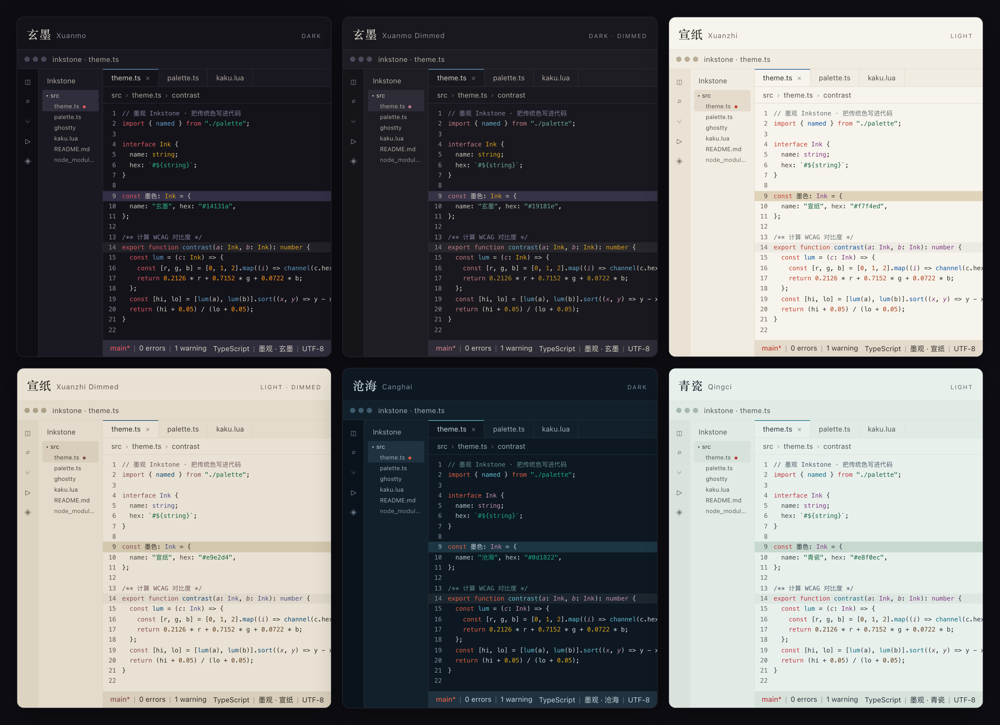

# 墨观 Inkstone


一套从 **526 个中国传统颜色** 里长出来的代码配色。墨纸组（玄墨 / 宣纸 + Dimmed）与海瓷组（沧海 / 青瓷）共六个变体，共用同一套色相骨架。

A traditional Chinese color theme for editors and terminals, built from the 526-color [zhongguose](https://zhongguose.com/) palette and the matching Figma color chart.



## 六个变体

### 墨与纸

| 变体 | 气质 | 画布 | 关键字 | 字符串 | 类型 |
| --- | --- | --- | --- | --- | --- |
| **玄墨 Xuanmo**（暗） | 松烟墨底，朱砂批注 | `#14131a` | 鱼鳃红 · 降彩 `#d8574a` | 铜绿 `#2bae85` | 萝兰紫 `#c08eaf` |
| **玄墨 Dimmed**（暗） | 深墨夜色，矿物色低一度 | `#19181e` | 桂红 · 降彩 `#c57f73` | 梧枝绿 `#69a794` | 土黄 `#d6a01d` |
| **宣纸 Xuanzhi**（暖亮） | 生宣暖白，青绿设色 | `#f7f4ed` | 鹤顶红 · 降彩 `#c34435` | 荷叶绿 `#1a6840` | 桔梗紫 `#813c85` |
| **宣纸 Dimmed**（暖亮） | 陈纸暖灰，深墨旧色 | `#e9e2d4` | 烟红 `#894e54` | 荷叶绿 `#1a6840` | 野菊紫 `#525288` |

### 海与瓷

| 变体 | 气质 | 画布 | 关键字 | 字符串 | 类型 |
| --- | --- | --- | --- | --- | --- |
| **沧海 Canghai**（暗） | 深海暮色，青绿矿物 | `#0d1822` | 银朱 · 降彩 `#dc5e41` | 竹绿 `#1ba784` | 萝兰紫 `#c08eaf` |
| **青瓷 Qingci**（亮） | 月白釉底，青灰题字 | `#e8f0ec` | 尖晶玉红 · 降彩 `#bc3a46` | 荷叶绿 `#1a6840` | 桔梗紫 `#813c85` |

- 墨纸组关键字用**朱批红**，呼应古籍朱笔批注：玄墨落在砖红/鱼鳃红一侧，宣纸落在鹤顶红一侧；海瓷组把银朱 / 尖晶玉红当作釉面上的印章。
- 海瓷组取青绿山水的矿物色：霁青、海青、竹绿、石绿，配少量暖色反光。
- 朱砂系保留传统色相与明度，只把彩度压到屏幕友好的范围，标注为「降彩」；错误态保留更高一档彩度。
- 暖色只留一层：玄墨的数字与类型不再同时占用杏黄 + 土黄，数字归土黄、类型归萝兰紫，杏黄只留给警告。
- Dimmed 只用于墨纸组：**降环境光，不降墨色**。画布更沉、墨色仍 ≥ 10.5:1，强调色保留可辨识的色相（C ≥ 0.045），避免褪成灰雾。
- 光标改用各变体的冷色交互色（羽扇豆蓝 / 涧石蓝 / 玉鈫蓝），不再复用关键字红。
- **红做记号，青做动作**：关键字、标签、错误、删除保留朱砂；按钮、徽标、进度、焦点、选中态、范围高亮、括号匹配与命令反馈统一用各变体的交互蓝（羽扇豆蓝 / 涧石蓝 / 飞燕草蓝 / 鷃蓝 / 霁青 / 玉鈫蓝），主操作与危险操作不再共用色相。
- 强调色尽量保留传统色原值；中性表面、弱化前景与降彩颜料均在 [色板文档](docs/palette.md) 中标注。
- 872 项检查：对比度上下限 + OKLCH 彩度带，六个变体执行同一套阈值。

## 安装

### GitHub Releases

每个版本都会在 [Releases](https://github.com/Konata9/inkstone/releases) 附带：

| 产物 | 用途 |
| --- | --- |
| `Konata9.inkstone-<version>.vsix` | VS Code / Cursor / Windsurf / VSCodium |
| `inkstone-ghostty-<version>.zip` | Ghostty 主题文件 |
| `inkstone-kaku-<version>.zip` | Kaku / WezTerm 色表（Lua + TOML） |
| `inkstone-opencode-<version>.zip` | OpenCode V2 主题 |
| `inkstone-<version>.zip` | 全部产物 + `manifest.json` + 安装说明 |
| `manifest.json` / `SHA256SUMS` | 机器可读索引与校验和 |

下面的本地安装方式仍然适用于从源码构建。

### VS Code / Cursor / Windsurf / VSCodium

从 [VS Code Marketplace](https://marketplace.visualstudio.com/items?itemName=Konata9.inkstone) 安装；VSCodium / Open VSX 用户使用 [Open VSX](https://open-vsx.org/extension/Konata9/inkstone)。也可以从 [Releases](https://github.com/Konata9/inkstone/releases) 下载最新 VSIX / 本地构建。

```bash
pnpm install
pnpm package:vscode
```

产物在 `dist/Konata9.inkstone-<version>.vsix`。安装：

```bash
code --install-extension dist/Konata9.inkstone-0.3.2.vsix
# Cursor:
cursor --install-extension dist/Konata9.inkstone-0.3.2.vsix
```

然后在命令面板执行 **Preferences: Color Theme**，选择：

- `墨观 · 玄墨 (Inkstone Xuanmo)`
- `墨观 · 玄墨 Dimmed (Inkstone Xuanmo Dimmed)`
- `墨观 · 宣纸 (Inkstone Xuanzhi)`
- `墨观 · 宣纸 Dimmed (Inkstone Xuanzhi Dimmed)`
- `墨观 · 沧海 (Inkstone Canghai)`
- `墨观 · 青瓷 (Inkstone Qingci)`

扩展 ID 为 `Konata9.inkstone`，同一份 VSIX 适用于所有 VS Code 衍生编辑器。

### Ghostty

```bash
pnpm install:ghostty
```

或手动复制：

```bash
mkdir -p ~/.config/ghostty/themes
cp "dist/ghostty/Inkstone Xuanmo" "dist/ghostty/Inkstone Xuanmo Dimmed" \
   "dist/ghostty/Inkstone Xuanzhi" "dist/ghostty/Inkstone Xuanzhi Dimmed" \
   "dist/ghostty/Inkstone Canghai" "dist/ghostty/Inkstone Qingci" \
   ~/.config/ghostty/themes/
```

在 `~/.config/ghostty/config` 中加入：

```ini
theme = light:Inkstone Xuanzhi,dark:Inkstone Xuanmo
```

想要低饱和的一对：

```ini
theme = light:Inkstone Xuanzhi Dimmed,dark:Inkstone Xuanmo Dimmed
```

想要海瓷组：

```ini
theme = light:Inkstone Qingci,dark:Inkstone Canghai
```

只想要一个变体就写 `theme = Inkstone Canghai`。`ghostty +list-themes` 可以确认主题已被识别。

### Kaku / WezTerm

Kaku 从 **0.27.1** 起会把 `~/.config/kaku/colors/` 里的 TOML 配色列进 Settings → Theme，所以安装脚本按版本分流：

```bash
pnpm install:kaku
```

脚本先读 `kaku --version`，没有 CLI 时读 `/Applications/Kaku.app` 里的版本号：

- **0.27.1 及以上**：只把六个 `.toml` 复制到 `~/.config/kaku/colors/`，并删掉旧版脚本留下的 `~/.config/kaku/inkstone-*.lua`。打开 Settings（`Cmd + ,`），Theme 列表里直接出现下表的六个名字，选中即可，Kaku 会自己写入 `config.color_scheme`。
- **低于 0.27.1 或没装 Kaku**：不写入任何文件，只提示版本过低；按下面的「旧版 Kaku / WezTerm」手动装 Lua 表。

| 变体 | Settings 里的名称 |
| --- | --- |
| 玄墨（dark） | `Inkstone Xuanmo` |
| 玄墨 Dimmed（muted dark） | `Inkstone Xuanmo Dimmed` |
| 宣纸（warm light） | `Inkstone Xuanzhi` |
| 宣纸 Dimmed（muted warm light） | `Inkstone Xuanzhi Dimmed` |
| 沧海（deep-sea dark） | `Inkstone Canghai` |
| 青瓷（celadon light） | `Inkstone Qingci` |

从旧脚本升级时注意：`kaku.lua` 里如果还留着 `dofile(wezterm.config_dir .. '/inkstone-xuanmo.lua')` 这类行，Lua 文件一被删掉就会报错，需要把这些行删掉或注释掉。已经选好的 `config.color_scheme = 'Inkstone Xuanmo'` 不用动，TOML 里的方案同名。

#### 旧版 Kaku / WezTerm（Lua）

0.27.1 之前的 Kaku（Settings 里只有 Auto / Kaku Dark / Kaku Light）和 WezTerm 继续用 Lua 表。手动把六个 `.lua` 复制到 Kaku 的配置目录：

```bash
mkdir -p ~/.config/kaku
cp dist/kaku/inkstone-*.lua ~/.config/kaku/
```

再把下面三行追加到 `~/.config/kaku/kaku.lua`（Kaku 会自动重载）：

```lua
config.color_schemes = config.color_schemes or {}
config.color_schemes['Inkstone Xuanmo'] = dofile(wezterm.config_dir .. '/inkstone-xuanmo.lua')
config.color_scheme = 'Inkstone Xuanmo'
```

想要暖色就把 `inkstone-xuanmo.lua` 与 `'Inkstone Xuanmo'` 换成上表里对应的文件与名称。

WezTerm 用户把六个 `.lua` 文件放到 `~/.config/wezterm/`，接入方式相同；也可以把 `.toml` 放进 `~/.config/wezterm/colors/`，再让 `config.color_scheme` 等于表里的名称。两种格式都同时包含 `tab_bar` 与 `split`。

### OpenCode

```bash
pnpm install:opencode
```

六个主题会复制到 `~/.config/opencode/themes/`。然后在 `~/.config/opencode/cli.json` 里指定：

```json
{
  "$schema": "https://opencode.ai/v2/cli.json",
  "theme": { "name": "inkstone-xuanmo-dimmed", "mode": "dark" }
}
```

也可以按 `Ctrl+P` → **Open settings** → **Theme**，或运行 `/themes` 直接切换。文件名就是主题名：

| 主题名 | 变体 | 模式 |
| --- | --- | --- |
| `inkstone-xuanmo` | 玄墨 | 暗 |
| `inkstone-xuanmo-dimmed` | 玄墨 Dimmed | 暗 |
| `inkstone-xuanzhi` | 宣纸 | 亮 |
| `inkstone-xuanzhi-dimmed` | 宣纸 Dimmed | 亮 |
| `inkstone-canghai` | 沧海 | 暗 |
| `inkstone-qingci` | 青瓷 | 亮 |

OpenCode 的语义 token 全部从同一份色板映射：正文、背景层、语法、diff、Markdown、反馈色与九级 hue scale 都由生成器输出；`accent` 与 `interactive` 都指向各变体的交互蓝，`destructive` 独占错误红。新增主题文件后需要重启 OpenCode。

## 仓库结构

```
src/
  color.ts                色彩工具：对比度、混色、alpha
  audit.ts                色板审计（构建时强制）
  check.ts                产物检查（主题 key、Ghostty、Lua 语法）
  checks.ts               build 与 validate 共用的检查入口
  palette/
    data/zhongguose.json  526 个中国传统颜色（唯一色值来源）
    data/SOURCE.md        数据来源与署名
    labels.ts             语义角色的中文标签（docs 与 preview 共用）
    xuanmo.ts             玄墨语义色板
    xuanmo-dimmed.ts      玄墨 Dimmed 语义色板
    xuanzhi.ts            宣纸语义色板
    xuanzhi-dimmed.ts     宣纸 Dimmed 语义色板
    canghai.ts            沧海语义色板
    qingci.ts             青瓷语义色板
  targets/
    naming.ts             各端文件名与主题显示名（唯一来源）
    vscode.ts             workbench + TextMate + 语义 token
    ghostty.ts            Ghostty 主题
    kaku.ts               Kaku / WezTerm 色表（Lua + TOML）
    opencode.ts           OpenCode V2 主题（base + hue scale）
    preview.ts            预览页 / gallery
    site.ts · site-copy.ts 官网数据注入（文案 / 版本 / 色板）
    docs.ts               色板文档
templates/site/           官网 Liquid 模板（结构 / CSS / JS）
scripts/                  安装脚本、VSIX 与 Release 打包
packages/vscode/          VS Code 扩展（VSIX）
dist/                     生成物：Ghostty 主题、Kaku 色表、OpenCode 主题、VSIX
preview/index.html        本地预览页（生成物）
preview/gallery.html      README / Marketplace 用的编辑器总览（生成物）
site/                     官网静态页（生成物，GitHub Pages）
docs/palette.md           色板对照表（生成物）
docs/preview.png          六个编辑器窗口截图（`pnpm capture:preview`）
docs/publishing.md        Marketplace / Open VSX 发布与 Trusted Publishing 配置
.github/workflows/        构建、打包与发布 CI
```

## 开发

需要 Node 20+（打包 VSIX 时 `vsce` 建议 Node 22）。

```bash
pnpm install
pnpm build        # 审计色板 → 清空 dist/ → 生成全部产物
pnpm test         # 色板审计 + 产物检查（与 build 的检查一致）
pnpm typecheck
pnpm preview      # 构建并在浏览器打开预览页
pnpm capture:preview  # 从 gallery.html 截取 docs/preview.png（需 Playwright）
pnpm site         # 构建并打开官网（site/index.html）
```

生成器保证各端一致：改一处色板，VS Code、Ghostty、Kaku、OpenCode 与官网同时更新。构建会拒绝落在对比度区间或彩度预算之外的配色。官网页面结构与样式在 `templates/site/`，构建只注入文案、版本与色板数据；默认英文（`site/`），中文在 `site/zh/`；页面 chrome 跟随系统明暗选用玄墨 / 宣纸，可切换六个变体。

### 设计约束

1. **三组光线**：墨纸组以墨与纸为底，Dimmed 把灯调暗而不是蒙灰；海瓷组以深海与青瓷釉为底。
2. **对比度是区间**：正文 10.5–12.5:1、语法色 4.5–9:1；过低伤可读性，过高伤耐受度。
3. **彩度有预算**：朱砂系 C ≤ 0.175，其余强调色 C ≤ 0.175，光标 C ≤ 0.105；超出时保留色相与明度、只压彩度。
4. **传统色可追溯**：`nameOf()` 反查原值，降彩颜料通过 `soften()` 记录来源，`docs/palette.md` 自动列出。
5. **同一骨架**：六个变体的色相顺序一致（朱 → 蓝 → 绿 → 橙 → 紫 → 青 → 绛），切换只换光线与饱和度。
6. **不做花活**：无渐变、无斜体注释、无玻璃拟态；只做耐看的纸墨与海色。
7. **红做记号，青做动作**：朱砂只留在语法、印章与危险态；按钮、徽标、进度、焦点与选中态用交互蓝，主操作和危险操作各占一个色相。

## 发布

稳定 tag（`v*`）会由 GitHub Actions 自动发布到 VS Code Marketplace 与 Open VSX；预发布 tag 只生成 GitHub prerelease。维护者配置、Open VSX Trusted Publishing 的首次 bootstrap 与重试方式见 [发布文档](docs/publishing.md)。

## 许可与致谢

- 代码以 [MIT](LICENSE) 发布。
- 色值来自 [zhongguose.com](https://zhongguose.com/)（作者 Perchouli）整理的 526 个中国传统颜色，与 Figma 社区色谱「526 个中国传统颜色」同为一套；传统色名属于公共文化资产。
- 架构上参考了 [Catppuccin](https://catppuccin.com/) 的多端生成方式，气质上受益于 Tokyo Night 与 Gruvbox 的克制。
- 预览页使用系统字体，无外部依赖；图标由 `scripts/make-icon.py` 生成。

---

## English

**Inkstone (墨观)** is a traditional Chinese color theme for VS Code-likes and terminals. It takes its accents from the 526-color `zhongguose` palette: cinnabar for keywords, verdigris for strings, turmeric for types, and layered ink neutrals.

- **Xuanmo (玄墨)** — dark, pine-soot ink and cinnabar annotations.
- **Xuanmo Dimmed** — dark, lower ambient light with pigments that keep their hue; ink still clears 10.5:1.
- **Xuanzhi (宣纸)** — warm light, raw xuan paper and mineral pigments.
- **Xuanzhi Dimmed** — warm light, aged paper and deeper ink; faded pigments, not grey ones.
- **Canghai (沧海)** — deep-sea twilight, blue-green minerals and a cinnabar seal.
- **Qingci (青瓷)** — cool light, moon-white celadon glaze and grey ink.

Install from the [VS Code Marketplace](https://marketplace.visualstudio.com/items?itemName=Konata9.inkstone) or [Open VSX](https://open-vsx.org/extension/Konata9/inkstone), or use the VSIX from `dist/`; the Ghostty / Kaku / OpenCode themes install with the scripts above. In Kaku 0.27.1 and newer the installer drops only the TOML schemes into `~/.config/kaku/colors/`; the same-named Lua scheme stays available for WezTerm and older Kaku builds.

Built with a generator: one semantic palette produces the VS Code themes, the Ghostty themes and the terminal ANSI schemes, and the build fails if any token leaves its contrast band or OKLCH chroma budget.

Red stays a mark (keywords, errors, deletions, the seal) while each flavor's interaction blue carries buttons, badges, progress, focus and selected chrome, so confirmation and destruction never share a hue.
