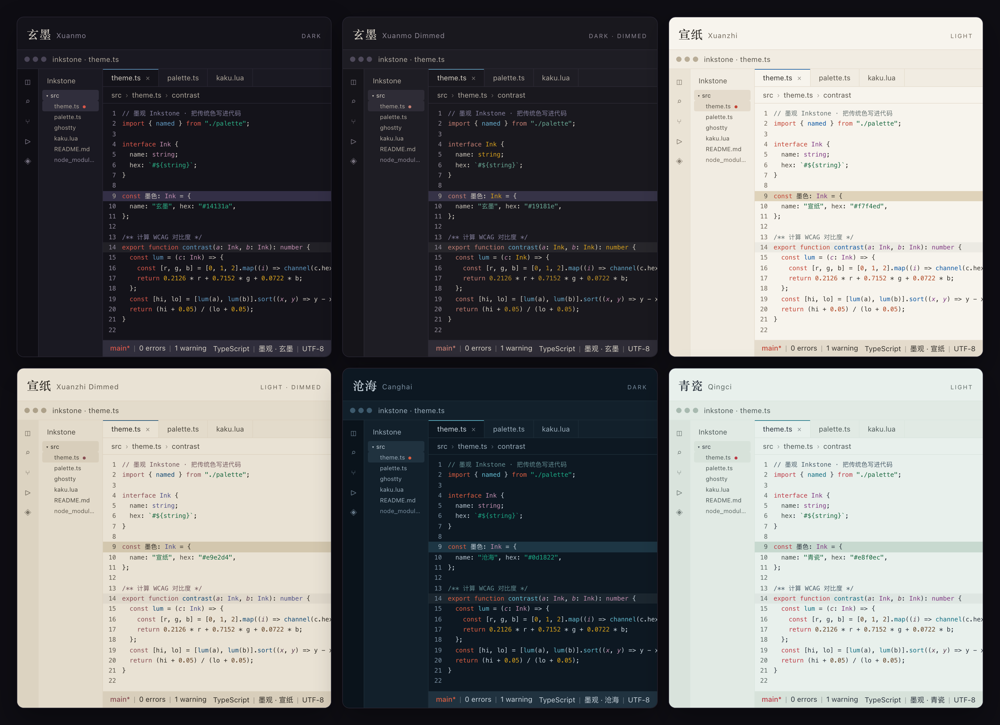

<div align="center">
  
  <h1>Inkstone 墨观</h1>
  <p>A code palette grown from <a href="https://zhongguose.com/">526 traditional Chinese colors</a>.</p>
  <p>
    <a href="https://konata9.github.io/inkstone/">Website</a> ·
    <a href="docs/README.md">Docs</a> ·
    <a href="https://github.com/Konata9/inkstone/releases">Releases</a> ·
    <a href="README.md">中文</a>
  </p>
  <p>
    <a href="https://konata9.github.io/inkstone/"></a>
    <a href="https://github.com/Konata9/inkstone/stargazers"></a>
    <a href="https://github.com/Konata9/inkstone/releases"></a>
    <a href="https://marketplace.visualstudio.com/items?itemName=Konata9.inkstone"></a>
    <a href="LICENSE"></a>
  </p>
</div>

## Preview



## Why Inkstone

Inkstone is not a random set of dark themes. It is one painting shown in six rooms under different light. Accents come from 526 traditional Chinese colors: cinnabar for keywords, verdigris or bamboo green for strings, turmeric or violet for types, and ink, paper, deep water or celadon glaze for the neutrals.

- **Six variants, one skeleton**: the hue order stays cinnabar → blue → green → orange → violet → cyan → crimson. Switching changes light and saturation, not the order.
- **Red marks, blue acts**: keywords, tags, errors and deletions keep cinnabar; buttons, badges, progress, focus and selected chrome use each variant's interaction blue.
- **Dimmed lowers the light, not the ink**: the canvas gets deeper while body text stays at ≥ 10.5:1 and pigments keep a recognisable hue instead of fading to grey.
- **The generator keeps every target in sync**: one semantic palette produces VS Code, Ghostty, Kaku, OpenCode, Zed and DSH themes, and the build rejects colors outside the contrast bands or chroma budget.

## Six variants

### Ink & paper

| Variant | Mood | Canvas | Keywords | Strings | Types |
| --- | --- | --- | --- | --- | --- |
| **Xuanmo 玄墨** (dark) | Pine-soot ink, cinnabar annotations | `#14131a` | 鱼鳃红 · softened `#d8574a` | 铜绿 `#2bae85` | 萝兰紫 `#c08eaf` |
| **Xuanmo Dimmed** (dark) | Deep ink night, minerals one step lower | `#19181e` | 桂红 · softened `#c57f73` | 梧枝绿 `#69a794` | 土黄 `#d6a01d` |
| **Xuanzhi 宣纸** (warm light) | Raw xuan paper, blue-green pigments | `#f7f4ed` | 鹤顶红 · softened `#c34435` | 荷叶绿 `#1a6840` | 桔梗紫 `#813c85` |
| **Xuanzhi Dimmed** (warm light) | Aged paper, deeper old ink | `#e9e2d4` | 烟红 `#894e54` | 荷叶绿 `#1a6840` | 野菊紫 `#525288` |

### Sea & celadon

| Variant | Mood | Canvas | Keywords | Strings | Types |
| --- | --- | --- | --- | --- | --- |
| **Canghai 沧海** (dark) | Deep-sea twilight, blue-green minerals | `#0d1822` | 银朱 · softened `#dc5e41` | 竹绿 `#1ba784` | 萝兰紫 `#c08eaf` |
| **Qingci 青瓷** (light) | Moon-white glaze, grey ink | `#e8f0ec` | 尖晶玉红 · softened `#bc3a46` | 荷叶绿 `#1a6840` | 桔梗紫 `#813c85` |

Every role, hex and contrast ratio is in the [palette reference](docs/palette.md).

## Supported software

**Editors**

| Software | Install |
| --- | --- |
| VS Code / Cursor / Windsurf / VSCodium | [Marketplace](https://marketplace.visualstudio.com/items?itemName=Konata9.inkstone) · [Open VSX](https://open-vsx.org/extension/Konata9/inkstone) · [VSIX](https://github.com/Konata9/inkstone/releases) |
| Zed | `pnpm install:zed` |

**Terminals and AI tools**

| Software | Install |
| --- | --- |
| Ghostty | `pnpm install:ghostty` |
| Kaku / WezTerm | `pnpm install:kaku` |
| OpenCode | `pnpm install:opencode` |
| DeepSeek Harness (DSH) | `pnpm install:dsh` |

## Install

### VS Code / Cursor / Windsurf / VSCodium

Install from the [VS Code Marketplace](https://marketplace.visualstudio.com/items?itemName=Konata9.inkstone) or [Open VSX](https://open-vsx.org/extension/Konata9/inkstone), or download the latest VSIX from [Releases](https://github.com/Konata9/inkstone/releases). The extension ID is `Konata9.inkstone`; one VSIX works in every VS Code-compatible editor.

Then run **Preferences: Color Theme** and pick:

- `墨观 · 玄墨 (Inkstone Xuanmo)`
- `墨观 · 玄墨 Dimmed (Inkstone Xuanmo Dimmed)`
- `墨观 · 宣纸 (Inkstone Xuanzhi)`
- `墨观 · 宣纸 Dimmed (Inkstone Xuanzhi Dimmed)`
- `墨观 · 沧海 (Inkstone Canghai)`
- `墨观 · 青瓷 (Inkstone Qingci)`

### Terminals and other editors

```bash
pnpm install
pnpm install:ghostty
pnpm install:kaku
pnpm install:opencode
pnpm install:zed
pnpm install:dsh
```

Each installer builds the themes first, then copies them into the app's config directory. Kaku 0.27.1+ uses TOML schemes, while older Kaku and WezTerm use Lua; DSH installs the six-theme menu edition by default and also ships Appearance-driven pair packages. If you do not want to clone the repository, download the matching zip from [Releases](https://github.com/Konata9/inkstone/releases); see [Installation](docs/installation.md) for manual copies, OpenCode settings, DSH pair packages and troubleshooting.

## Docs

| Document | Contents |
| --- | --- |
| [Design](docs/design.md) | Three light families, six variants, hue skeleton, contrast and chroma budgets |
| [Palette reference](docs/palette.md) | Every semantic role, hex, traditional color name and canvas contrast |
| [Installation](docs/installation.md) | Manual install for every platform, legacy Kaku, DSH pairs and troubleshooting |
| [Development](docs/development.md) | Repository layout, commands, generation pipeline and extending targets |
| [Publishing](docs/publishing.md) | Two release streams, Marketplace / Open VSX, prereleases and retries |

## Credits and license

- Code is released under the [MIT license](LICENSE).
- Colors come from the 526 traditional Chinese colors collected at [zhongguose.com](https://zhongguose.com/) by Perchouli, the same set as the Figma community chart "526 个中国传统颜色"; the traditional names are part of the public cultural commons.
- The multi-target generator is inspired by [Catppuccin](https://catppuccin.com/); the restraint owes something to Tokyo Night and Gruvbox.
- The preview uses system fonts and no external runtime; the icon is generated by `scripts/make-icon.py`.
